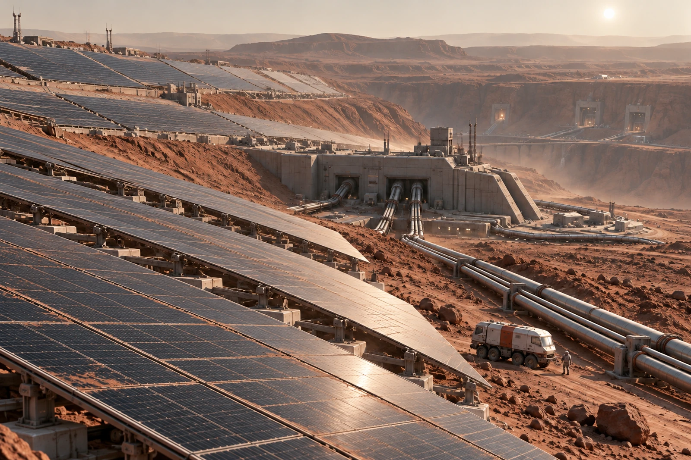

# 火星北侧供能坡地 · 清扫队错峰告示

旧清扫刷只准扫支架，不碰光学与电气表面。工具员在领用单上画了分界，刷柄磨白，刷毛仍有上一班的细尘。

覆尘复核按阵区进行，不以总览图上深浅相同判定发电或损伤程度。坡地远处面板依地形排列，管廊把它们接向变换与贮配工区；扫尘小机与密封服务车在实际工作带内，未从人员路线抄近道。

两队预约同一维护段，早班提出在运行队后方边走边扫，调度未准，按设备状态与粉尘影响重新排出错峰。增加的等候列调度时段，不改作清扫员出勤不足。原计划九段，本班实际做六段，三段顺延。

## 不靠拍亮的复核

摄影员交了清扫前后图，日照角度不同，后一张显得更亮。性能复核只收相应测量与同条件对照，不用亮度改善直接写增发比例。图像可说明清扫位置与设备外观，权限写在它能支持的范围。

清出的尘样按采集段留袋，袋上“废物”改为“待分析尘样”，不直接倒进生活垃圾处理。工作车气闸周边另行清洁，不能把面板扫净就宣称车已适合回住区。

刷子三把出、三把回，其中一把柄裂，停用装袋。早班人员提议扔掉，工具员说台账先退，实物再进相应去向。末班领回的是两把可继续检查使用的刷，不是库存凭空少了一把。

告示贴在服务门内。远处灰色坡地仍旧很大，本班只签那六段。
