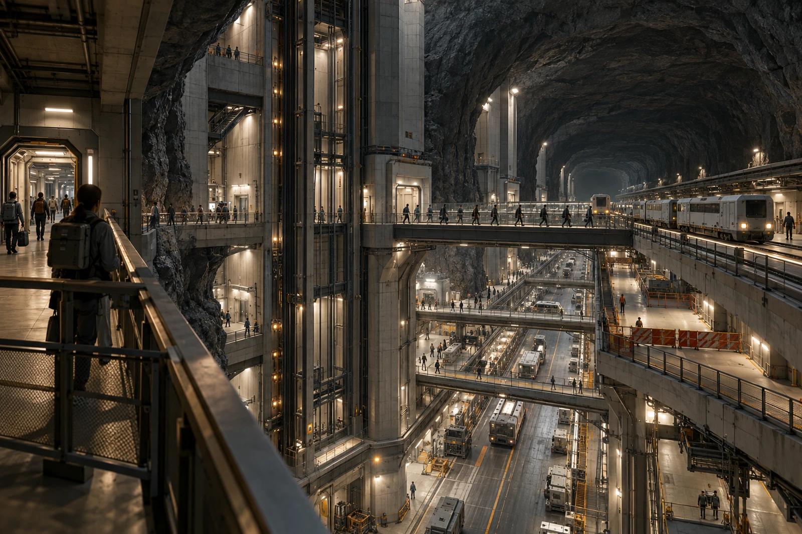

# 火星地下换乘处 · 便携氧包领还表

本表不记录医疗诊断。便携氧包按用途、设备状态与领还对象发放，不因名字出现在换乘协助名单上就推定其患有某种病。

第二竖井封闭后，旅客转往侧井。大厅有多层平台、压力分隔、封闭转运车和沿岩壁延伸的步道，远处那部看得见的升降机并不一定通向当前站台。路线图须保留门与层之间的真实连接，不把深井画成一个明亮大洞让人自己猜。

| 氧包位置/状态 | 只 |
|---|---:|
| 领出 | 8 |
| 已归还 | 6 |
| 随护理转送单继续使用 | 2 |

护理站签的是临时保管，不替设备检验岗签复位合格。库存显示“八只全还”的第一版表作废留存，不能在备注里只补一句两只在外。

## 等候席边上的名字

一位申请人在纸联上给家属补写了旧站台名，担心来人找不到。窗口保留原话，并在公开联系卡上只列新的到达点，不将整份照料说明贴到墙上。家属到站后按本人联系方式核对，没有让人站在大厅里大声报病史。

氧包接口与外表按回收流程处理，外观干净不代表可再发放。六只已回的设备中四只完成复核，两只待检。售票处不得从“归还六只”推算“可借六只”。

大厅留证画面中，普通衣着旅客只出现在已加压公共区域，远端设备井有完整隔断。摄影申请将隔断玻璃反光抹掉，本组要求保留边框与门状态，免得同一幅图被读作裸岩全空腔都可呼吸。

最后一张归还签被箭头贴纸压住，掀开后未损字。贴纸换位，签名原样。
