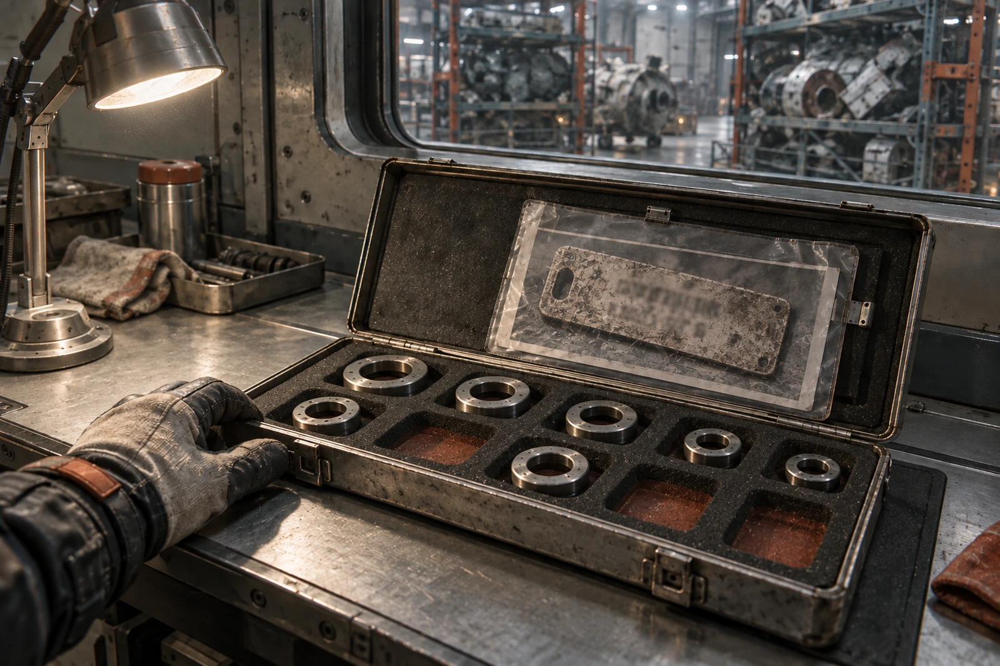

# 外轨拆船仓C12 · 随货禁混条

货类：量规盒及附件，合计6.400千克。原船主申请“老式工艺完整套装”计价，检验台不同意“完整”二字，改列旧工具混批。

盒盖泡沫共有十个槽。实到量规七件，空槽三处。空槽中的压痕可见，不能作为“工具仍在”的凭证。

## 今日称量

| 科目 | 千克 | 结算口径 |
|---|---:|---|
| 七件量规 | 3.860 | 待分材质，不作精度担保 |
| 金属盒壳 | 2.120 | 可回收金属 |
| 泡沫及衬垫 | 0.370 | 分离处理 |
| 随盒纸件及照片夹 | 0.050 | 档案附件，不入炉 |
| 合计 | 6.400 | 与到货台账一致 |

量规上仍有校准标记。最新可读的一次停在2097年，缺此后十五年保存与使用记录；买方不得沿用旧日期开具新检验证明。三件量规可进入重新校准流程，未过检前与另外四件同属待判。

卖方附了第六维修坞梁端牌照片，援引GS-2066-03，称本盒与该梁同批退役。照片角落确有“24/29”差异注记，原单只证实当时的拆离见证与材料交割，没有这个量规盒。运输链中间缺四十六年，不补写。

我们退回的是关联主张，不退回这张照片。卖方愿意将照片随货，档案附件签字后留存。原铭牌未到仓，本地透明夹不标“金属原物”。

## 费用单两联

计费不以金属价格一项包干。分选占台四十分钟、计量预约三件、衬垫处理一袋，按本仓挂牌费率另计。七件中若有重新合格者，复检后单独议价；卖方不能预支这个差额。旧制造者的名字不计入本仓复检收入。

经办人将“原厂校准”章按在收货联上，位置错误，已横划并签认。正确章位是“收件数量”。纸件背面有第二个浅印，出自垫纸，不作为第二次收件。

## 买方自提栏

买方只申请领走空盒，拟装家用缝补件。仓库未放行：当前混批尚未分拆结算，空盒也在质量总账内。允许预约，不允许先拿。预约卡号码C12-88，钉在盒盖提把上。

交班时仍有三处空槽。不要拿散料补满再拍目录照。
