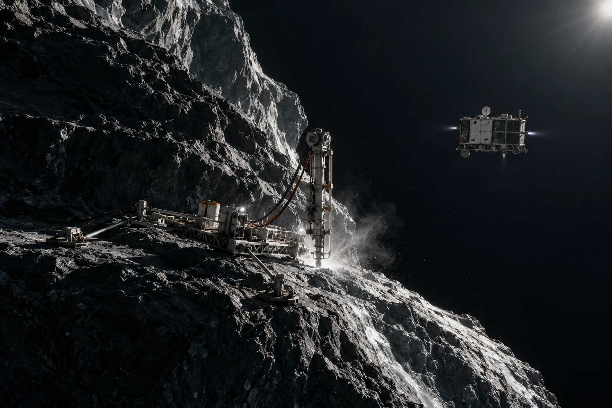

# 远日彗核采料架 · 航迹留证单

锚固试片未写稳固地基。它记录的是本次接触和约束试验，不能替彗核全体给出长期地质保证。

近旁伴飞载体保持约定工作状态，采料机构由受控约束接近目标面。松散物、局部升华与设备相互作用分别记录，不按地球矿坑经验预设一块朝下承受所有散料的地面。活动局部若有稀薄喷出，只按真空中扩展的形态留证，不画成翻滚烟团。

## 两条轨迹

计划轨迹保留为计划，实际轨迹按当次遥测入档。偏离一处已由原任务岗位处置，摄影员只能标注画面时间与可见位置，不能从几张图补造一条“更平滑”的实际轨迹。

样件一件收存，空白接触片一件另存；两者照片相似，标签随原身份，不为目录简洁合成同一件。“采得物”须等相应检测判定，不将所有贴在片上的亮点写作目标天体物质。

外场总览让近端机构、服务器件、锚固位置与远处不规则核体形成比例。主体伸出画面仍可推知体积，载体不靠冒险贴近裂口来显得渺小。大背景没有夸张的彩色长尾，工作时所处环境与光照另附原记录。

最后一段封签边在装袋时卷起，保管员换外套，不重新给试片生成一次采样时间。旧封签留作附件，新外套标明更换原因。航迹的偏离记录同样留着；把纸换平整，不把已经发生的动作换成原计划。
