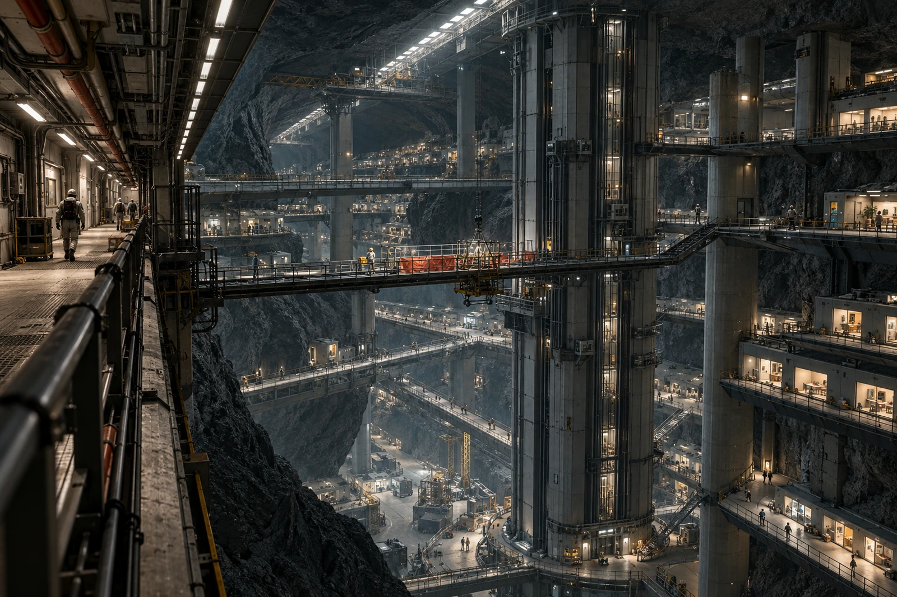

# 第八竖井 · 居民绕行通知底联

贴在旧桥口的地图，有一条手画短线。线从配给点直接接到住宅层，穿过本次停用的照明检修段。绘线者在图边写：“我一直这么走。”本处保留原图，覆盖新通行图，不凭这句话开放检修段。

竖井四层照明回路分段维护，关闭的只是其中一处跨桥。住宅、管线和步道沿岩腔分层延伸，绕行须先下半层再转回。对面看得见的那扇门不是这边可以直接抵达的门，登记窗口不得按照片上的直线给老人计算路程。

申请通行协助十二户，其中三户撤回、两户改时、七户保留。志愿者按七户实际预约排班，名单不与医疗记录混贴。有人只需代取食物，有人需要陪同走到另一座升降井，不一概登记“不能行走”。

## 贴图人的复述

> 原广播：第八竖井关闭。
> 更正稿：第八竖井住宅侧B桥关闭，主井仍开。

原稿使居民以为所有上下通行均停。原广播录音作废留存，新通知不追记成从来就说得正确。

全景摄于上层检修点。近处栏杆、人行门、下层桥和深处住宅灯窗共同留在画面里，关闭的一桥应能找到，不能把整个洞穴压暗到只剩一排漂亮的灯。生活区仍在过日子，不是停用的展厅。

七户服务完成六户；最后一户主动改到明晨。值班员写了“七户结清”，本人当场划去，留下六次实际签收。改期条压在旧图的短线上。夜班从这里开始数，不从上一班对“完成”的说法开始数。
