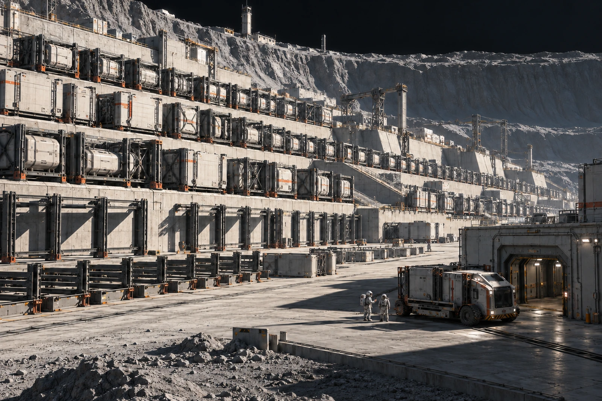

# 旧城备件坡地 · 空架保管单

第二百号货位取消，空架不报废。原牌从货柜上卸下后仍绑在梁上，今天盘点人照牌报来一箱，复核时看见的是空的。

货位取消通知只到采购端，未到夜班库管。夜班以为柜子仍在背阴一列，按旧路径让运输车绕进空区。车在隔离架前停车，未发生装货，也没有一件货在途中丢失。本单将错误拆成目录状态与现场导航两项，不向司机追收“漏运”费。

整片坡地按地形层层铺开，活跃架区与拆空基础并列。照片保留近端一辆密封服务车和远处气闸，空架之间的黑色间隔须看得清。采购部门申请用旧满仓照片替换，说新版显得萧条；拒绝。库存不是景观密度。

## 三个去向

取消货位的库存条目归历史；实物架归维护资产；旧吊牌归本次差错附件。三者不可一键删除。若以后新货入架，按新入库记录配置位置，不沿用第二百号的过去履历。

库房将当日架面清扫单夹入保管袋。清扫不算重新启用。放在空架上的临时工具盒由班组领回，不能留在那里让下次航拍又识别出一个“箱”。

结算员只冲销一趟未发生的提货服务，实际绕行与安全停车按原班次记账。没有把空货位的历史采购价冲作今日损失，也未为无货架开材料合格证。

卸牌员在保管栏签名，发现签在领货栏，划去重签。两处名字都留。空架今晚照常检查，检查卡标题仍写空架。
