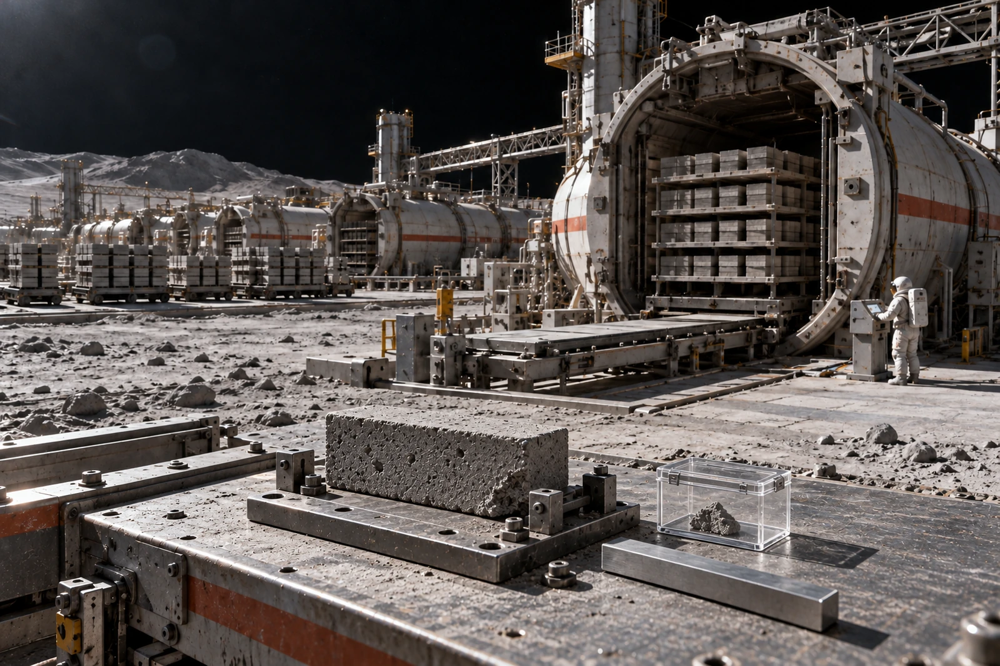

# 静海烧结场 · 第三炉签认联

**炉次**：SH-3-20410617-B　**交班时刻**：06:40　**去向**：第五运输槽，尚未放行。

## 留在检具里的那一块

卸料簿第十七行原写“齐角”，斜划一道，改为“裂角”。蓝色记号笔在真空外场不能用；划线系回舱后补录，补录时刻07:16。原始图像仍附在炉次袋，禁止用补录图替换。

见证砖长240毫米、宽115毫米、厚70毫米，卸料时质量4.36千克。右下角剥落一片，回收碎片0.018千克，主样称量4.342千克。两件合计与卸料秤数相同。碎片装入透明硬盒，盒盖内侧留有检验员手套磨出的半月形雾痕。盒与砖共用留样号CW-17；号牌只系在托架上，不刻入受检表面。

本批预定用于无压设备基座的垫块，不用于载人舱壳，不作防辐射层厚度凭据。第三炉加热末段记录有六分钟功率下调，原因栏写“供电母线限载”，没有写“合格”。请下班不要替上班补这两个字。

## 炉次账与抽检账

| 去向 | 数量/块 | 处置 |
|---|---:|---|
| 外观完整、进入待验槽 | 112 | 随机抽十二块后再放行 |
| 可见裂纹、进入返工槽 | 7 | 破碎后重新配料 |
| CW-17留样 | 1 | 主样与碎片一并封存 |
| 合计 | 120 | 与入炉托位数核对相符 |

十二块随机样中三块做破坏压缩试验，九块用于热循环。破坏样不得算进交付数。施工组原申请当班提走112块，物料员已将申请数量圈住：现时112是待验数。最终提单另开。

## 返工人员签认

检验员阮青，工号SH-Q-061：07:18签。卸料机手卢岸，工号SH-M-114：07:22签。供电值班栏无人签名，附值班记录，不以他人笔迹代填。

卢岸申请将本炉等候检验的42分钟记为无故停机，班长批“设备停机，人员未离岗”。计时从06:40起，不从补录的07:16起。复核用气闸出入记录；录像中卢岸第三次抬右手，是调整袖口，不作指挥信号。该帧不用于认定违章。

## 留样柜附条

CW-17放三层柜左端，砖底不涂胶，碎片盒不压在砖上。以后若移柜，先称量再拆封。别把断角补齐。

**07:31，接班收件**：一块、一个盒、一张被划掉的卸料单。柜钥匙收到。
