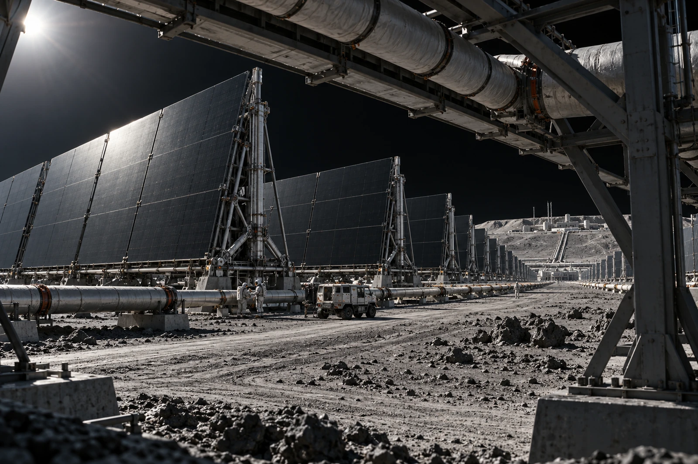

# 静海热排场 · 冷端检修窗班卡

蓝色检修牌从热端入口取下时，绳结还紧着。前班将它挂在最显眼的地方，检修组按牌走到入口，发现该分区仍在承担运行热负荷，未开阀。

本班调整的是两片冷备区的维护窗口，不是全场停机。远坡密排的板面看起来相同，近处管路上的隔离位置与温度记录并不相同。蓝牌随工单搬到冷备入口，旧悬挂点的照片仍附本卡，防止下一班按旧照片找门。

| 分区 | 来班状态 | 本班允许动作 |
|---|---|---|
| 东一 | 运行 | 远距巡看 |
| 东二 | 冷备隔离 | 复核后检修 |
| 东三 | 运行 | 不进入 |

停泵、隔断、泄压及工作温度各自签认，任何一个“已停”不替代其余项。被退回的第一份卡只勾了停泵，未列出余热消退记录，已经注销工作许可。没有人因此补写一个降温完成时刻。

检修人从主管支架往远处拍了一张总览，板列一层层跨过地形，最远端退入日照下的黑面。宣传处希望把冷区也画成暗红色，便于表现“散热”；退回。实物在此工况下没有肉眼可见的红光，温度写在测量记录里，不涂在照片上。

领工具三件，收回三件；蓝牌一张，仍随冷备区工单。原误挂点另挂灰色作废联，未留蓝色残片作指示。值班工程师写：“远看是一片板，近处是三个不同的班。”然后把东三栏的空签名格折进透明套，留待它实际停用的那一天。
