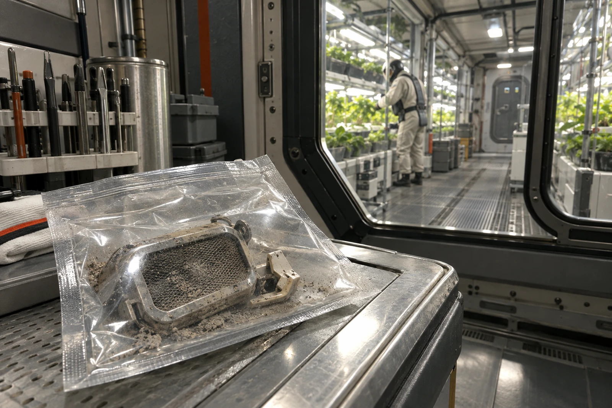

# 第三温室工具口 · 不准跨门

工单GH3-46-1016。回风支路停机后，先关双侧隔断，再拆滤盒。拆下物不通过生活区；样袋外表擦净，只能送本舱检验台。

滤盒前盖右扣断去一角，断口朝里。拆卸前照片已入本机，不用库中同型号完好件照片补齐。现场未见肉眼可辨霉斑，不能据此勾“无污染”。

### 08:06—09:18操作栏

08:06，支路隔断位置双人核认。08:11，第一只袋置入拆卸托盘。08:17，前盖移出，掉落封口片一枚，已收入独立小袋，不塞回卡槽。08:23，外袋封口。08:31，备用滤盒安装。08:46，压差恢复至本舱运行卡允许区间。09:18，门边工具车封签。

本单不发放解除隔离许可。培养观察、分子筛查及植物健康巡查各走原表；快筛阴性不替代培养结果。

| 交接物 | 数量 | 去向 |
|---|---:|---|
| 旧滤芯及前盖 | 1套 | 舱内检验台，双袋 |
| 断封口片 | 1枚 | 小袋随旧件 |
| 扭矩扳手 | 1把 | 本舱擦拭后回架 |
| 借自第二温室的长柄钩 | 1把 | 留在污工具柜，暂不退 |

工具钩借用期到今日，第二温室窗口已自动扣逾时一班。工具员申请销扣，理由填“防疫扣留”。对方回条：可以撤销逾时费，但不能把库存状态改成“已归还”。两项分别办理。

### 没有病人的病历夹

午间诊室收到一条“第三温室感染”提醒。值班员查原工单，发现自动摘要把“待检环境样”转写为“感染者样本”。已撤回提醒，保留转写日志。人员健康监测照常执行，不为补齐表格登记一个患者。

滤盒装入前的湿质量为2.184千克；拆后封袋总质量2.263千克，空双袋及封条0.079千克，扣除后仍为2.184千克。此数仅作收样核对，不证明滤芯没有截留物，也不把潮气和灰尘分作生物增量。

### 工具柜手写签

长柄钩握把有一道白线，是第二温室的持有人记号，不是清洁标志。去污完成后另挂合格牌，不能把白线擦掉冒充处理完毕。

封口片袋口写了“角”。接班员补上“滤盒扣角”，原字未划。
